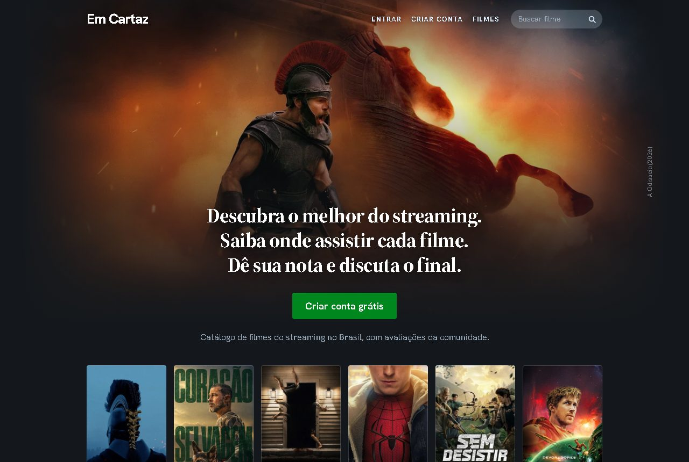
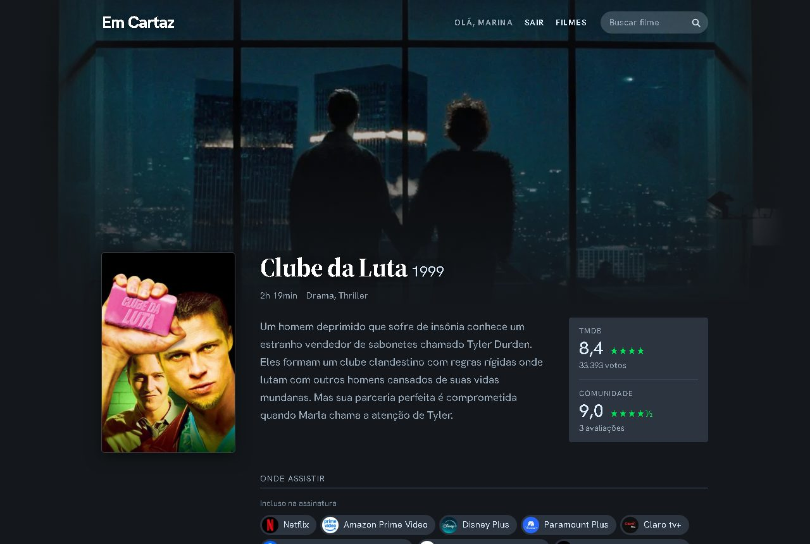
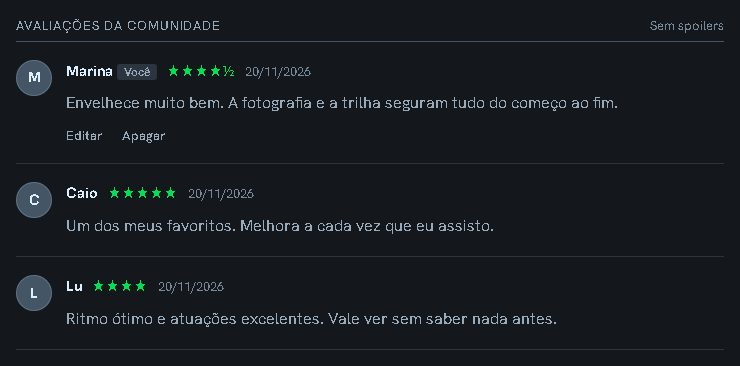
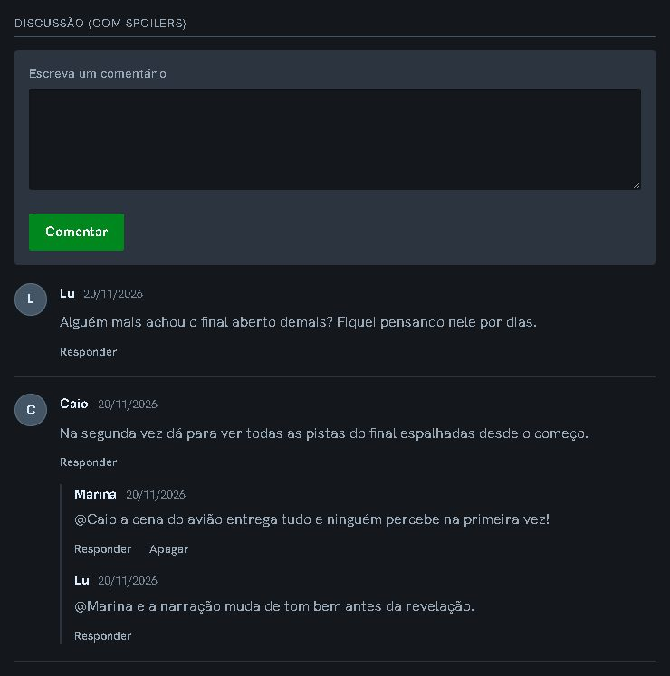
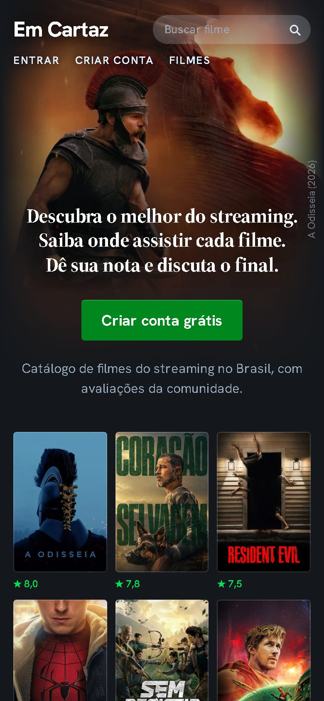
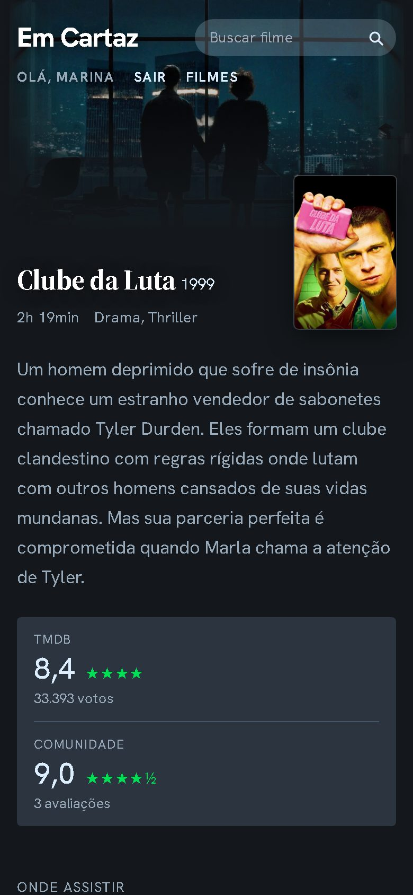

# Em Cartaz

Site para descobrir **os melhores filmes disponíveis agora nos streamings do Brasil**, buscar um filme e ver **onde assistir**, com notas e resenhas do TMDB.

Projeto de estudo, feito com HTML, CSS e JavaScript puro no navegador e um servidor Node.js + Express.

## O que tem no site

- **Página inicial:** os filmes mais bem avaliados (ou mais populares) incluídos na assinatura de algum streaming, com filtro por serviço (Netflix, Prime Video, Max...).
- **Busca:** encontre qualquer filme pelo nome.
- **Página do filme:** sinopse, nota, onde assistir no Brasil (assinatura, grátis, aluguel, compra) e resenhas.
- **Comunidade:** com uma conta, você dá a sua nota, escreve o que achou (sem spoilers) e conversa na Discussão, que fica fechada até você dizer que já assistiu.

## Como é o site





### Comunidade

| Avaliações (sem spoilers) | Discussão (com spoilers) |
|---|---|
|  |  |

### No celular

<p>
  
  &nbsp;&nbsp;
  
</p>

<sub>As contas, avaliações e comentários das fotos são exemplos. Pôsteres e imagens dos filmes: TMDB.</sub>

## Como rodar no seu computador

Você precisa do [Node.js](https://nodejs.org/) (versão 22 ou mais nova).

1. **Pegue um token do TMDB:** crie uma conta em [themoviedb.org](https://www.themoviedb.org/signup), vá em *Configurações → API* e copie o **API Read Access Token** (o código longo que começa com `eyJ`).
2. **Configure o token:** copie o arquivo `.env.example` para um novo arquivo chamado `.env` e cole o token depois de `TMDB_TOKEN=`.
3. **Instale as dependências:**
   ```
   npm install
   ```
4. **Ligue o site:**
   ```
   npm run dev
   ```
   Depois, abra **http://localhost:3000** no navegador.

Para conferir se o token funciona: `node --env-file=.env scripts/testar-conexao.js` deve mostrar `Clube da Luta`.

## Testes

```
npm test
```

## Como o projeto está organizado

```
server/   o servidor (guarda o token, conversa com o TMDB e cuida das contas e da comunidade)
dados/    o banco de dados local (fora do git)
public/   o site que roda no navegador (HTML, CSS, JS)
test/     os testes automáticos
docs/     o design e o plano do projeto
```

O navegador só conversa com o nosso servidor (`/api/...`). Quem fala com o TMDB é o servidor, porque é ele que guarda o token.

## Comunidade (fase 2)

Na página de cada filme, quem tem conta pode:

- **avaliar** o filme (nota de 1 a 10 e um texto opcional, sem spoilers);
- conversar na **Discussão (com spoilers)**, que fica fechada até a pessoa clicar em "Já assisti, quero ver".

Ler não exige conta. Escrever exige.

### Como testar com duas pessoas

1. Ligue o site (`npm run dev`) e abra http://localhost:3000.
2. No navegador normal, clique em **Entrar → Criar conta** e crie a conta A.
3. Abra uma **janela anônima** (Ctrl+Shift+N) e crie a conta B. Cada janela guarda o próprio login.
4. Avalie e comente o mesmo filme com as duas contas e responda uma à outra.

### Onde ficam os dados

- O banco de dados é o arquivo `dados/em-cartaz.db` (SQLite), criado sozinho quando o servidor liga.
- Ele **não vai para o git** (está no `.gitignore`), porque guarda e-mails.
- As senhas nunca são guardadas: só um "hash" delas.
- Para **recomeçar do zero**, desligue o servidor, apague o arquivo `dados/em-cartaz.db` e ligue de novo.

## Créditos

- Este produto usa a API do [TMDB](https://www.themoviedb.org/), mas não é endossado nem certificado pelo TMDB.
- Dados de onde assistir: [JustWatch](https://www.justwatch.com/).
